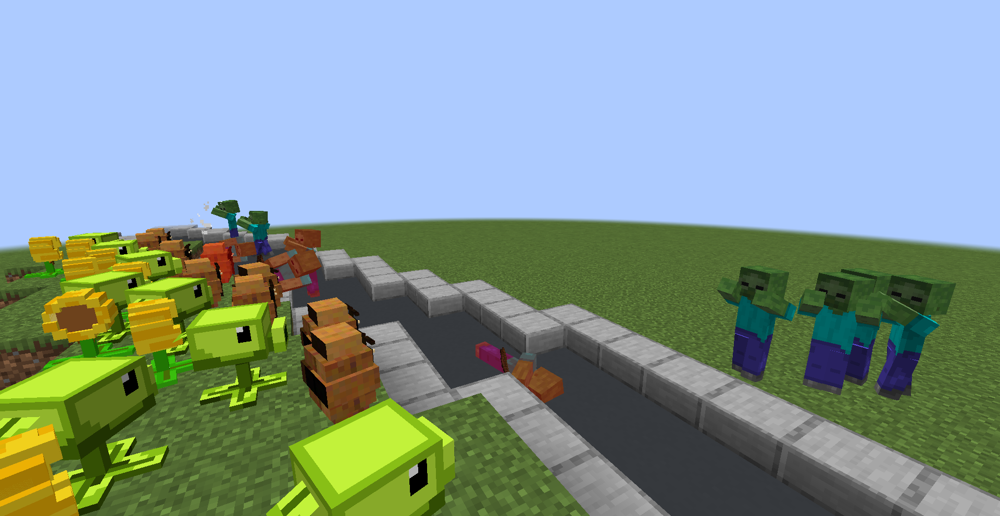
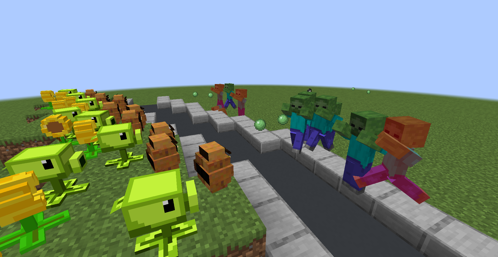
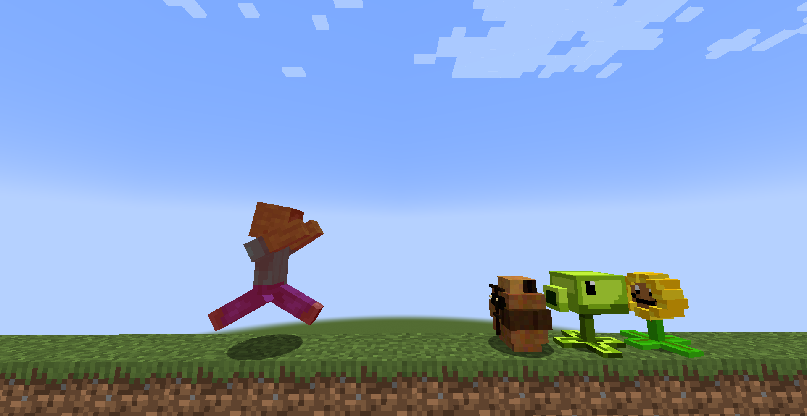

# PlantVSZombie

A playable Minecraft 1.20.1 Fabric mod prototype inspired by lane-defense games. The project turns Minecraft mobs into a small Plants-vs-Zombies-style combat sandbox with placeable plants, zombie targeting, sun economy, and visible projectile combat.

This is an unofficial fan-made prototype for learning, entertainment, and portfolio proof. It is not affiliated with Mojang, Microsoft, PopCap, or EA.



## What This Shows

- Custom Minecraft Fabric entities for Peashooter, Sunflower, Wall-nut, and pea projectiles.
- A playable defense loop: place plants, generate sun, block zombies, and shoot hostile mobs.
- Zombie behavior changes through mixins so zombies prioritize plant targets.
- Custom item models and renderers that make the plants readable in-game.
- A small portfolio-ready modding project built with Java, Fabric, and iterative AI-assisted development.

## Screenshots

### Peashooter Combat

Peashooters detect hostile `Monster` targets in front of them and fire pea projectiles at zombies.



### Plant Lineup

The prototype includes multiple plant roles: Sunflowers for economy, Wall-nuts for defense, and Peashooters for damage.



## Key Features

- **Peashooter targeting and shooting**: Finds hostile monsters in a forward cone, tracks the target, and fires no-gravity pea projectiles.
- **Pea projectile damage**: Projectiles damage living targets while ignoring friendly plant entities.
- **Zombie plant targeting**: Zombies can target Wall-nuts, Peashooters, and Sunflowers, making the defense loop interactive.
- **Sun economy**: Sunflowers produce sun, and seed packets consume sun for stronger plants.
- **Seed packet placement**: Players can place Peashooters, Sunflowers, and Wall-nuts through custom items.
- **Plant guide book**: Gives seed packets, sets plant facing direction, and allows returning plants to seed packets.
- **Custom rendering**: Plant entities use Minecraft item model rendering so the prototype can iterate quickly on Blockbench-style assets.

## Tech Stack

- **Game**: Minecraft 1.20.1
- **Mod loader**: Fabric Loader
- **API**: Fabric API
- **Language**: Java 17
- **Build**: Gradle / Fabric Loom
- **Client visuals**: Custom entity renderers and JSON item models
- **AI workflow**: Codex-assisted debugging, feature iteration, and README/portfolio packaging

## My Role

- Designed the PvZ-style gameplay loop inside Minecraft constraints.
- Implemented custom entities, registries, seed packet items, projectile behavior, and zombie AI mixins.
- Debugged targeting behavior across several iterations: spawn/render fixes, AI goal fixes, rotation, and Peashooter firing filters.
- Built the portfolio README with in-game proof screenshots from the Fabric dev client.
- Packaged the project so a viewer can understand the result in under a minute.

## Interesting Implementation Details

- Peashooters stay stationary by stopping navigation and zeroing velocity each tick.
- Targeting uses a manual-facing cone so placed plants defend the direction chosen by the player.
- Projectile spawn position is offset from the Peashooter's head direction to make shots look like they come from the mouth.
- Pea projectiles disable gravity and discard themselves after impact or a short lifetime.
- Zombies are modified with mixins instead of replacing vanilla zombie code directly.

## How To Run

Requirements:

- JDK 17
- Minecraft 1.20.1
- Fabric Loader
- Fabric API

Run the development client:

```powershell
.\gradlew.bat runClient
```

Build the mod jar:

```powershell
.\gradlew.bat build
```

The built jar will be generated in:

```text
build/libs/
```

## Quick Gameplay Test

1. Launch with `.\gradlew.bat runClient`.
2. Create or open a creative test world.
3. Use the Plant Guide Book or seed packets to place Sunflowers, Peashooters, and Wall-nuts.
4. Face the direction you want a plant to defend before placing it.
5. Spawn zombies or use the zombie spawner block.
6. Watch Peashooters fire at hostile monsters while Wall-nuts absorb pressure.

Useful summon command:

```mcfunction
/summon plantvszombie:peashooter
```

## Project Layout

```text
src/main/java/com/saharat/plantvszombie/
  entity/      Custom plant and projectile entities
  item/        Seed packets and plant guide book
  mixin/       Vanilla zombie behavior changes
  registry/   Entity, item, and block registration

src/client/java/com/saharat/plantvszombie/client/
  render/      Client-side entity renderers and model layers

src/main/resources/
  assets/      Models, textures, lang files, and blockstates
  fabric.mod.json
  plantvszombie.mixins.json
```

## Portfolio Notes

This repo is strongest as a Minecraft modding proof:

- Shows Java gameplay systems inside an existing engine.
- Shows AI behavior and entity interaction, not just static items.
- Has visual proof from real in-game screenshots.
- Has a clear before/after story: a static plant prototype becomes a playable lane-defense combat loop.

## License / Asset Note

This project is currently a learning prototype. Review assets, naming, and third-party inspiration before using it commercially or publishing it as an official portfolio centerpiece.
